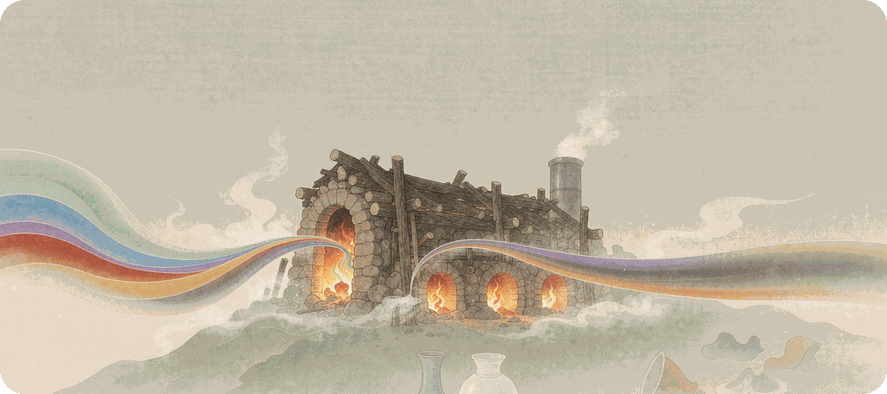

<div align="center">

# 窑变 for Obsidian



> One color in, ten thousand glazes out.

[中文](README_zh.md) · **English**

[Upstream Composer](https://github.com/vran-dev/obsidian-composer) · [Palettes from yaobian-theme](https://github.com/Sum-su/yaobian-theme)

</div>

---

## About

An Obsidian theme, forked from [Composer](https://github.com/vran-dev/obsidian-composer) with personal refinements for comfortable reading and writing. It ships **39 color schemes** (light & dark pairs), all switchable via the `style settings` plugin; the upstream typography — paragraph tracking / line height, heading decorations and callout styles — is preserved, while tables, lists and highlights are left to Obsidian's native rendering.

## Changes vs Upstream

- **Removed** the 「Ní 霓」 scheme and all [Components](https://cp.cc1234.cc/) plugin settings & styles
- **Removed** the whole "Color Settings" section (background pickers, rainbow tree tweaks) — colors are fully owned by the schemes now
- **Removed** table, list and highlight styles (incl. `--highlight-opacity`) in favor of Obsidian's native rendering, ready for other plugins to take over
- **Added** 72 color schemes (36 families × light/dark), each accent derived from its family's primary color and guaranteed ≥ 2.5:1 contrast against the editor background
- **Fixed** an upstream bug: the view-header title toggle's setting id did not match its CSS selector

## Color Schemes

> [!NOTE]
> Switching schemes requires the [Style Settings](https://github.com/mgmeyers/obsidian-style-settings) plugin; pick one for light and one for dark mode.

**Built-in · from upstream (3 families)**

- Xiá 霞 · Sù 素 · Qīng 青

**Ported · from yaobian-theme (36 families × light/dark = 72 schemes)**

Chinese style · 25 families

- 禅棕 `chan-zong` · 长安 `chang-an` · 春梅 `chun-mei` · 丹霞 `dan-xia` · 汉白玉 `han-bai-yu`
- 湖光 `hu-guang` · 金镶玉 `jin-xiang-yu` · 流云 `liu-yun` · 琵琶 `pi-pa` · 青瓷 `qing-ci`
- 青花 `qing-hua` · 青雾 `qing-wu` · 汝窑蓝 `ru-yao-lan` · 汝窑绿 `ru-yao-lv` · 山水 `shan-shui`
- 素宣 `su-xuan` · 天水 `tian-shui` · 宣纸 `xuan-zhi` · 雁灰 `yan-hui` · 烟雨 `yan-yu`
- 胭脂 `yan-zhi` · 羊皮纸 `yang-pi-zhi` · 窑火 `yao-huo` · 玉石 `yu-shi` · 紫陶 `zi-tao`

Others · 11 families

- Claude `claude` · Claude·Auroral `claude-auroral` · Dopamine · Dracula · 歌蕾蒂娅 `gladiia`
- Mint · 莫奈 `mo-nai` · 暮山紫 `mu-shan-zi` · 奶茶 `nai-cha`
- Peppa · Pulse · Vitesse Soft

## Getting Started

1. Download `theme.css` into `.obsidian/themes/Yaobian/` inside your vault
2. Settings → Appearance → Themes, select **Yaobian**
3. Install the [Style Settings](https://github.com/mgmeyers/obsidian-style-settings) plugin and pick a color scheme in the theme settings

> [!TIP]
> To let each scheme show its own accent color, keep Obsidian's "Appearance → Accent color" at default — a manually picked accent overrides the theme.

## Development

**Porting** — the 36 families come from the 72 VS Code theme definitions in [yaobian-theme](https://github.com/Sum-su/yaobian-theme): `editor.background` / `editor.foreground` build the backgrounds and the twelve-step color ramp, `button.background` becomes each family's accent (converted to HSL, lightness nudged to guarantee ≥ 2.5:1 contrast), and keys like `sideBar`, `textBlockquote` and `textCodeBlock` map onto their Obsidian counterparts; text highlights follow Obsidian's native colors (aligned with upstream PR #58).

**Build** — Style Settings declarations and styles are maintained separately: `settings.yml` holds the options, `yaobian.css` holds the styles, and `build.mjs` merges the two into the final `theme.css`.

```bash
npm run build        # settings.yml + yaobian.css -> theme.css
npm version patch    # release: builds and syncs manifest.json / versions.json
```

> [!NOTE]
> `theme.css` is a build artifact — do not hand-edit its YAML header.

## Thanks

- Forked from the [Composer theme](https://github.com/vran-dev/obsidian-composer) by @vran
- Color palettes ported from [yaobian-theme](https://github.com/Sum-su/yaobian-theme) (窑变) by @Sum-su, whose colors trace back to the [cherrycss.com](https://cherrycss.com) gallery
- The Claude·Auroral palette is ported from [claude-light-theme](https://github.com/AuroralFrost/claude-light-theme) by @AuroralFrost (matched light & dark VS Code themes), coexisting with the original Claude

---

<div align="center">

Released under the MIT License · One color in, ten thousand glazes out

</div>
