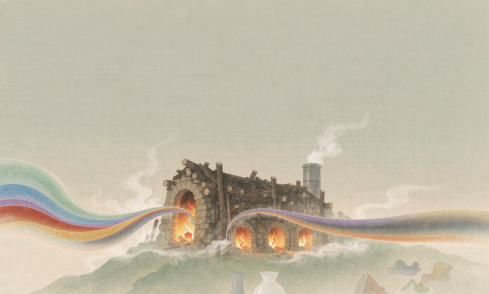

<div align="center">

# 窑变 for Obsidian



> One kiln, ten thousand glazes — the same recipe, different firing, each with its own color.

[中文](README_zh.md) · **English**

[Upstream Composer](https://github.com/vran-dev/obsidian-composer) · [Palettes from yaobian-theme](https://github.com/Sum-su/yaobian-theme)

</div>

---

## About

An Obsidian theme, forked from [Composer](https://github.com/vran-dev/obsidian-composer) with personal refinements for comfortable reading and writing. It ships **39 color schemes** (light & dark pairs), all switchable via the `style settings` plugin.

## Highlights

- **39 schemes, paired light/dark** — keeps the upstream Xiá / Sù / Qīng families, plus all 36 color families ported from [yaobian-theme](https://github.com/Sum-su/yaobian-theme)
- **A theme color per family** — each accent is derived from its family's primary color and guaranteed ≥ 2.5:1 contrast against the editor background
- **A restrained settings panel** — the Ní scheme, Components plugin config and redundant color pickers are removed; only typographic options remain
- **Upstream typography intact** — paragraph tracking / line height, heading decorations, list markers, callout and table styles are all preserved

## Getting Started

1. Download `theme.css` into `.obsidian/themes/Yaobian/` inside your vault
2. Settings → Appearance → Themes, select **Yaobian**
3. Install the [Style Settings](https://github.com/mgmeyers/obsidian-style-settings) plugin and pick a color scheme in the theme settings

> [!TIP]
> To let each scheme show its own accent color, keep Obsidian's "Appearance → Accent color" at default — a manually picked accent overrides the theme.

## Color Schemes

**Built-in · from upstream**

| | | |
| --- | --- | --- |
| Xiá 霞 | Sù 素 | Qīng 青 |

**Ported · from yaobian-theme (36 families, light & dark each)**

Chinese style · 25 families

| | | | | |
| --- | --- | --- | --- | --- |
| 禅棕 `chan-zong` | 长安 `chang-an` | 春梅 `chun-mei` | 丹霞 `dan-xia` | 汉白玉 `han-bai-yu` |
| 湖光 `hu-guang` | 金镶玉 `jin-xiang-yu` | 流云 `liu-yun` | 琵琶 `pi-pa` | 青瓷 `qing-ci` |
| 青花 `qing-hua` | 青雾 `qing-wu` | 汝窑蓝 `ru-yao-lan` | 汝窑绿 `ru-yao-lv` | 山水 `shan-shui` |
| 素宣 `su-xuan` | 天水 `tian-shui` | 宣纸 `xuan-zhi` | 雁灰 `yan-hui` | 烟雨 `yan-yu` |
| 胭脂 `yan-zhi` | 羊皮纸 `yang-pi-zhi` | 窑火 `yao-huo` | 玉石 `yu-shi` | 紫陶 `zi-tao` |

Others · 11 families

| | | | | |
| --- | --- | --- | --- | --- |
| Claude | Dopamine | Dracula | 歌蕾蒂娅 `gladiia` | Mint |
| 莫奈 `mo-nai` | 暮山紫 `mu-shan-zi` | 奶茶 `nai-cha` | Peppa | Pulse `pulse-interactive` |
| Vitesse Soft `vitesse-soft` | | | | |

## Changes vs Upstream

- **Removed** the 「Ní 霓」 scheme and all [Components](https://cp.cc1234.cc/) plugin settings & styles
- **Removed** the whole "Color Settings" section (background pickers & rainbow tree tweaks) — colors are fully owned by the schemes now
- **Added** 72 color schemes, each with a contrast-guaranteed accent
- **Fixed** an upstream bug: the view-header title toggle's setting id did not match its CSS selector

## Thanks

- Forked from the [Composer theme](https://github.com/vran-dev/obsidian-composer) by @vran
- Color palettes ported from [yaobian-theme](https://github.com/Sum-su/yaobian-theme) (窑变) by @Sum-su, whose colors trace back to the [cherrycss.com](https://cherrycss.com) gallery
- Task checkbox style referenced from the [Minimal theme](https://github.com/kepano/obsidian-minimal) by @Kepano

<details>
<summary>Development (settings.yml + composer.css split build)</summary>

Style Settings declarations and CSS are maintained separately, merged by a build script:

- `settings.yml` — Style Settings declarations (pure YAML)
- `composer.css` — style body (pure CSS)
- `build.mjs` — merges the two into `theme.css`

```bash
# after editing settings.yml / composer.css
npm run build        # regenerate theme.css
npm version patch    # release: builds and updates manifest.json / versions.json
```

Note: `theme.css` is a build artifact — do not hand-edit its YAML header.

</details>

---

<div align="center">

Released under the MIT License · One kiln, ten thousand glazes

</div>
